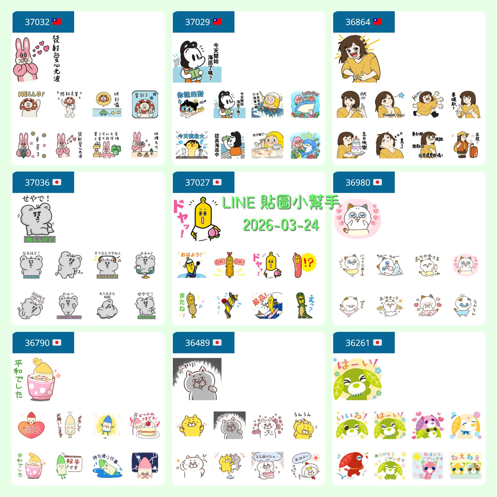

# TextCards - 九宮格卡片生成器



這是一個基於 Node.js 與 Sharp 影像處理庫開發的自動化工具，旨在將多張圖片快速合併成專業的「九宮格卡片式（Card Style）」圖片。支援圓角處理、間距控制、自動置中排列，以及進階的文字疊加功能。

## 🌟 主要功能

- **九宮格合併**：自動讀取目錄圖片，生成自定義行列（預設 3x3）的網格圖。
- **卡片風格**：每張小圖支援獨立的**圓角半徑**與**邊框間距**。
- **自動置中**：指定畫布大小後，九宮格內容會自動在畫布置中對齊。
- **進階文字疊加**：
  - 支援 `\n` 手動換行。
  - **自動亮度感應 (Auto Luminance)**：根據背景深淺自動切換文字顏色。
  - **多行背景框 (Title Background)**：增強標題在複雜背景下的易讀性。
  - **精確偏移微調**：可手動微調文字的 X, Y 座標。
- **全參數化設定**：透過 `grid.json` 即可控制所有外觀細節，無需修改程式碼。
- **高效處理**：使用 `sharp` 高效能影像處理庫，速度快且記憶體佔用低。

## 🛠️ 安裝說明

1. 確保已安裝 [Node.js](https://nodejs.org/) (建議 v18 以上)。
2. 安裝必要套件：
   ```bash
   npm install sharp
   ```

## 🚀 使用方法

1. 將原始圖檔放入 `raw_images` 資料夾。
2. 編輯 `grid.json` 調整您需要的參數。
3. 執行程式：
   ```bash
   node merge-images.js
   ```
4. 結果將儲存在 `final_posts` 資料夾中。

## ⚙️ 設定檔 (grid.json) 參數說明

| 參數 | 說明 |
| :--- | :--- |
| `canvas_width` / `canvas_height` | 最終畫布的大小。設為 0 則由內容自動決定。 |
| `card_width` / `card_height` | 每張小卡片的寬度與高度。 |
| `spacing` | 卡片與卡片之間的間距。 |
| `radius` | 卡片圓角半徑。 |
| `force_jpg` | 是否強制輸出為 JPG (預設為 true)。若為 false 則輸出帶透明背景之 PNG。 |
| `background_color` | 畫布背景顏色 (RGBA 格式)。 |
| `text_overlay.title` | 疊加在正中央的標題，支援 `\n`。 |
| `text_overlay.font_size` | 固定字體大小。設為 0 則依照畫布比例自動縮放。 |
| `text_overlay.offset_x` / `offset_y` | 標題位置的像素級微調。 |

## 📦 依賴項目

- [sharp](https://github.com/lovell/sharp) - 高效能影像處理引擎。
